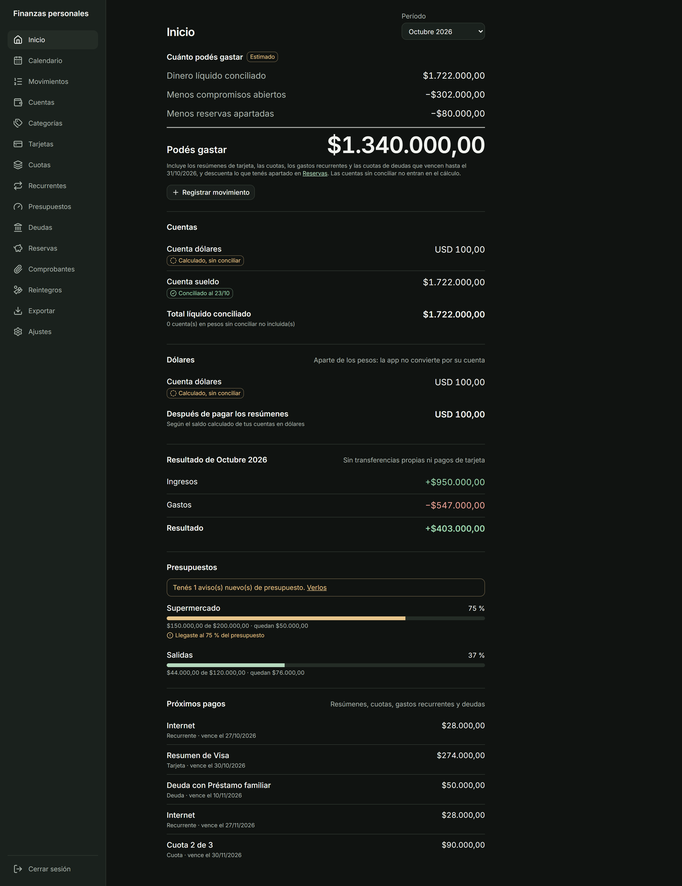
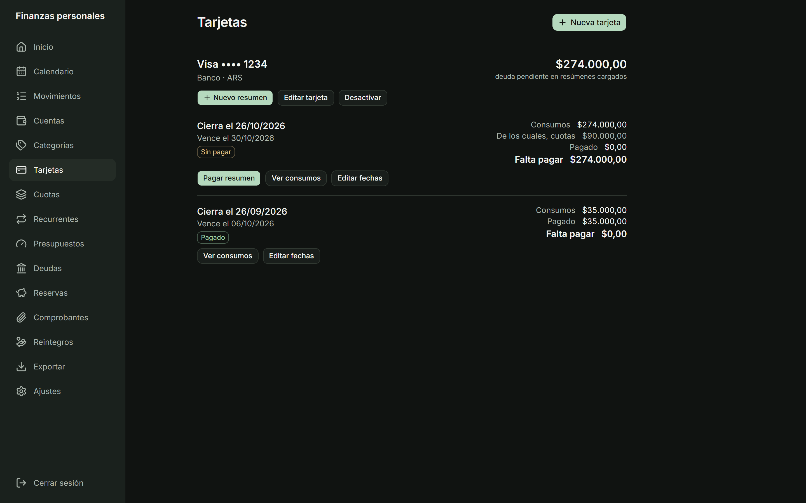
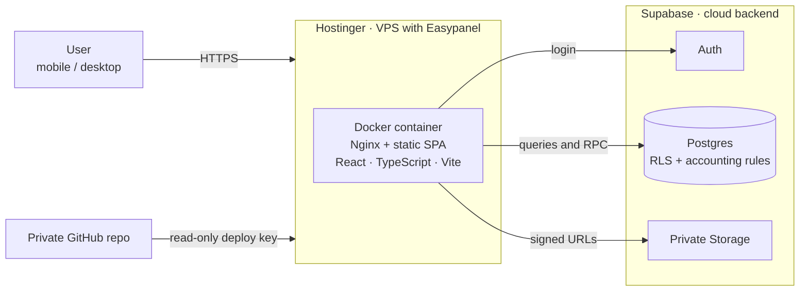

# Personal Finance App — Product Case Study

🇬🇧 English · 🇪🇸 [Español](README.md)

> A web app to understand personal finances (ARS and USD) with one priority: **the numbers must add up**. Nothing is counted twice, and every balance says where it comes from.

**Role:** Product Manager and product owner: scope, business rules, decisions, QA and launch.
**How it was built:** with **Claude Code**, in stages with prior approval and test cases defined before coding.
**Status:** in production, used daily for personal finances.
**Code:** private. This repository contains the case study only.

🎬 **Demo video (4 min):**

https://github.com/user-attachments/assets/081a8802-fa57-483d-94e4-5e814653c890

[Ver todas las capturas](docs/capturas.md)
## By the numbers

| Indicator | Result |
|---|---|
| Business test cases | **34 of 35** covered (the remaining one is partial by scope decision) |
| Automated database tests | **460 assertions** |
| Performance with 20,000 transactions | lists **< 15 ms**, summary and balances **< 20 ms** |
| Security | RLS on every table · 0 vulnerabilities in production code |
| Backups | restore **tested** and verified |

## STAR case

**Situation.** The spreadsheets and expense apps I tried failed where it hurts: paying the credit card statement was counted as another expense, transfers between my own accounts showed up as income and spending, pending rebates looked like available cash, and my real USD flow was not handled by any of them. I could not answer the basic question: **how much can I spend without missing my commitments?**

**Task.** Design and launch, end to end and on my own, an app that separates expenses, cash movements, debt and future commitments; projects upcoming payments without duplicating them; works on mobile and desktop with private data; and is **provably correct** (35 test cases defined upfront).

**Action.**
- **Product before code:** a scope document with 16 business rules and 35 test cases. Working rule: plan each stage and wait for my approval before building.
- **Decisions with documented trade-offs** (installments, budgets, USD, reserves, rebates): see [`docs/decisions.en.md`](docs/decisions.en.md).
- **Accounting rules live in the database**, not in the UI: atomic, idempotent operations, soft-delete with audit trail. See [`docs/architecture.en.md`](docs/architecture.en.md).
- **Staged delivery with quality gates:** each stage closed only when its test cases passed.
- **Security and operations as part of the product:** permissions audit, load test, separate test environment and backups with a tested restore.
- **AI with judgment:** Claude Code built under my rules (no secrets in the frontend, no real data in tests, one stage at a time). I made the decisions, reviewed and verified.

**Result.** The app is live and answers the original question: **"You can spend"** subtracts commitments and reserves without double counting, and is only calculated when an account has been reconciled. All acceptance criteria were met, with one documented exception.

**Lessons learned.**
- Putting the accounting rules in the database prevented the most errors.
- When two criteria coexist (recognized expense vs. cash), explain them on screen.
- One of my own changes reopened a permission that had already been fixed; there is now a test that guards it.

## Architecture at a glance

The frontend is static; **all accounting logic and security live in Supabase**. Full detail in [`docs/architecture.en.md`](docs/architecture.en.md).

## What's next

CSV statement import, an onboarding video and an **informational monthly review by an AI agent (n8n)**, with user consent, aggregated data and figures computed by the database, not by the model.

## Contact

**Agustin Montoban Cabral** · [LinkedIn](https://www.linkedin.com/in/your-profile) · [montobanagustin@gmail.com]

---
All rights reserved. This repository documents a case study; the application code is private.

---

_Sample data is fictional. No real financial data is published in this repository._
