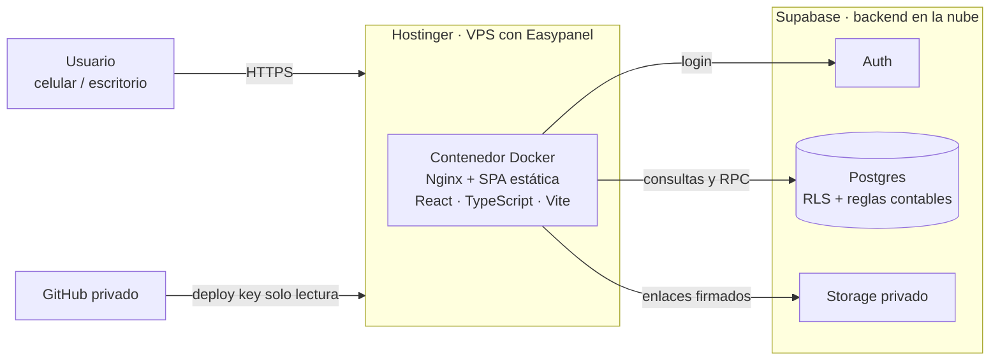

# Finanzas Personales — caso de producto

🇪🇸 Español · 🇬🇧 [English](README.en.md)

> App web para entender las finanzas personales (ARS y USD) con una prioridad: **que los números cierren**. Nada se cuenta dos veces y cada saldo dice de dónde sale.

**Rol:** Product Manager y dueño del producto: definición, reglas de negocio, decisiones, QA y lanzamiento.
**Cómo se construyó:** con **Claude Code**, bajo etapas con aprobación previa y casos de prueba definidos antes de programar.
**Estado:** en producción, uso personal diario.
**Código:** privado. Este repositorio es solo el caso de estudio.

🎬 **Video demo (4 min):** _[pegar enlace]_

[Ver todas las capturas](docs/capturas.md)

## En números

| Indicador | Resultado |
|---|---|
| Casos de prueba de negocio | **34 de 35** cubiertos (el restante, parcial por decisión de alcance) |
| Pruebas automáticas de base de datos | **460 aserciones** |
| Rendimiento con 20.000 movimientos | listados **< 15 ms**, resumen y saldos **< 20 ms** |
| Seguridad | RLS en todas las tablas · 0 vulnerabilidades en producción |
| Backups | restauración **probada** y verificada |

## Caso STAR

**Situación.** Las planillas y apps de gastos que probé fallaban donde duele: pagar el resumen de la tarjeta se contaba como otro gasto, las transferencias propias aparecían como ingresos y gastos, los reintegros pendientes parecían plata disponible, y mi circuito con dólares no estaba resuelto en ninguna. No podía responder la pregunta básica: **¿cuánto puedo gastar sin faltar a mis compromisos?**

**Tarea.** Diseñar y lanzar, de punta a punta y en solitario, una app que separe gasto, movimiento de caja, deuda y compromiso futuro; proyecte pagos sin duplicarlos; funcione en celular y escritorio con datos privados; y sea **demostrablemente correcta** (35 casos de prueba definidos de antemano).

**Acción.**
- **Producto antes que código:** documento de alcance con 16 reglas de negocio y 35 casos de prueba. Regla de trabajo: planificar cada etapa y esperar mi aprobación antes de programar.
- **Decisiones con trade-offs documentados** (cuotas, presupuestos, dólares, reservas, reintegros): ver [`docs/decisiones.md`](docs/decisiones.md).
- **Las reglas contables viven en la base de datos**, no en la pantalla: operaciones atómicas e idempotentes, anulación lógica con auditoría. Ver [`docs/arquitectura.md`](docs/arquitectura.md).
- **Etapas con compuertas de calidad:** cada una cerraba cuando sus casos de prueba pasaban.
- **Seguridad y operación como parte del producto:** auditoría de permisos, prueba de carga, ambiente de pruebas separado y backups con restauración probada.
- **IA con criterio:** Claude Code programó bajo mis reglas (sin secretos en el frontend, sin datos reales en pruebas, una etapa por vez). Yo decidí, revisé y verifiqué.

**Resultado.** La app está en producción y responde la pregunta original: **"Podés gastar"** descuenta compromisos y reservas sin duplicar, y solo se calcula cuando hay una cuenta conciliada. Todos los criterios de aceptación se cumplieron, con una excepción documentada.

**Aprendizajes.**
- Poner la regla contable en la base de datos fue la decisión que más errores evitó.
- Cuando conviven dos criterios (gasto reconocido vs. caja), hay que explicarlos en pantalla.
- Un cambio mío reabrió un permiso ya corregido; por eso hoy hay una prueba que lo vigila.

## Arquitectura en una imagen

El frontend es estático; **toda la lógica contable y la seguridad viven en Supabase**. Detalle completo en [`docs/arquitectura.md`](docs/arquitectura.md).

## Qué viene

Importación de extractos por CSV, video de onboarding y un **diagnóstico mensual informativo con un agente de IA (n8n)**, con consentimiento, datos agregados y cifras calculadas por la base, no por el modelo.

## Contacto

**[Agustin Montoban Cabral]** · [LinkedIn](https://www.linkedin.com/in/agustinmontobancabral) · [montobanagustin@gmail.com]

---

_Datos de ejemplo ficticios. Ningún dato financiero real se publica en este repositorio._
