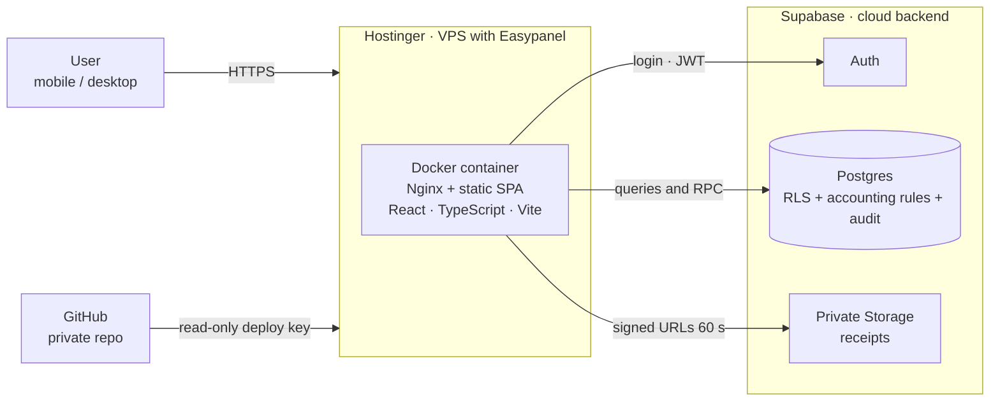
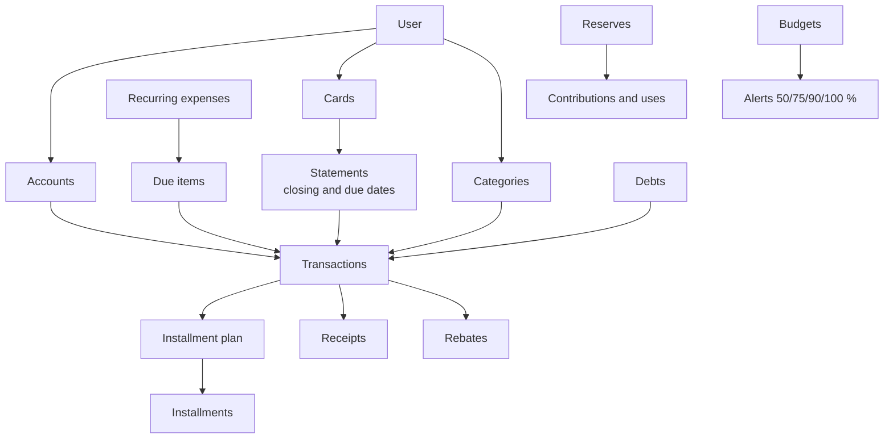

# Architecture

[← Back to README](../README.en.md)

## Overview

**Core idea:** the frontend is a static application with no server of its own. All accounting logic and security live in Supabase; the hosting only serves files.

## Hosting and deployment

| Component | Role |
|---|---|
| **Hostinger (VPS)** | Hosts the frontend container. No financial data lives here |
| **Easypanel** | Container panel on the VPS: builds the Docker image from the repository, runs it and manages the HTTPS domain |
| **Docker + Nginx** | Two-stage image: builds the app with Vite and serves it with Nginx, with security headers and a content security policy (CSP) |
| **GitHub (private)** | Deployment source. Easypanel pulls with a read-only *deploy key*, no personal credentials |
| **Supabase (cloud)** | Managed Postgres, Auth and Storage. The only place that holds data |

**Delivery flow**
1. Build and test in **development** (local environment + a development Supabase project with test data).
2. Take a **backup** of the production database.
3. Apply **migrations** to production, always before publishing the code that needs them.
4. Push the code to GitHub and run *Deploy* in Easypanel, which rebuilds and publishes the container.

**Why this separation:** changing or scaling the hosting never touches the data, and no server secret reaches the browser. The frontend only carries Supabase's public key; security is enforced by the database's RLS policies.

## Layers

| Layer | Technology | Responsibility |
|---|---|---|
| Presentation | React 19, TypeScript, Tailwind, shadcn/ui | One screen per module (home, transactions, accounts, cards, installments, recurring, budgets, debts, reserves, calendar, receipts, rebates, export, settings). Dark, minimalist, mobile-first |
| State and forms | TanStack Query, React Hook Form, Zod | Server data and client-side validation (amounts accepted only in Argentine format) |
| Domain logic | Pure, tested modules | Calculations, local dates (Buenos Aires), exact decimal money |
| Data and rules | Postgres (Supabase) | Versioned schema migrations, views, transactional functions (RPC), triggers |
| Identity and access | Supabase Auth + RLS | Each user sees only their own data; public sign-up closed |
| Files | Supabase Storage | Private bucket, per-user folder, JPG/PNG/WebP/PDF only, 10 MB max |
| Delivery | Hostinger + Easypanel, Docker + Nginx | Static frontend in a container, with security headers and CSP |

## Design principles

1. **The database is the source of truth.** Budgets, alerts, balances and statements are computed in Postgres; the frontend duplicates no rules.
2. **Exact money.** Decimal numeric type, never floats; positive amounts with a type/direction (a single sign convention).
3. **Atomic, idempotent compound operations.** Transfers, statement, installment and debt payments, rebates and reserves go through transactional functions with an idempotency key (a double click doesn't duplicate).
4. **Nothing is truly deleted.** Soft-delete with reason and audit trail. The only exception ("Reset data") requires a typed phrase and a recent password, and leaves a record.
5. **Least privilege.** Anonymous users have no permissions; tables with accounting rules are written only via RPC; no server secrets in the frontend.
6. **No double counting by design.** An installment purchase is a single expense; its installments are commitments. An installment already included in a card statement is not listed separately.

## Conceptual model

## Quality and operations

- **Three test layers:** database (rules, permissions, user isolation; 460 assertions), app logic (220+) and end-to-end runs with temporary users.
- **Performance:** with 20,000 transactions, lists < 15 ms and summary, balances and budgets < 20 ms at the database.
- **Security:** RLS on every table, private receipts with 60-second signed URLs, 0 vulnerabilities in published code, public sign-up closed.
- **Environments:** development for building and testing; separate production. Backup before every production database change.
- **Versioned migrations** (16 in total) and a restore verified by fingerprint and hash.

## Known limits

- Single-user use; no bank connection or automatic import (planned as a future iteration).
- Installments are always equal and monthly; no weekly or biweekly frequency for recurring expenses.
- Budget alerts are in-app only (no push or email).
