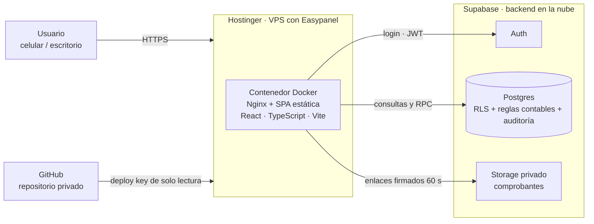
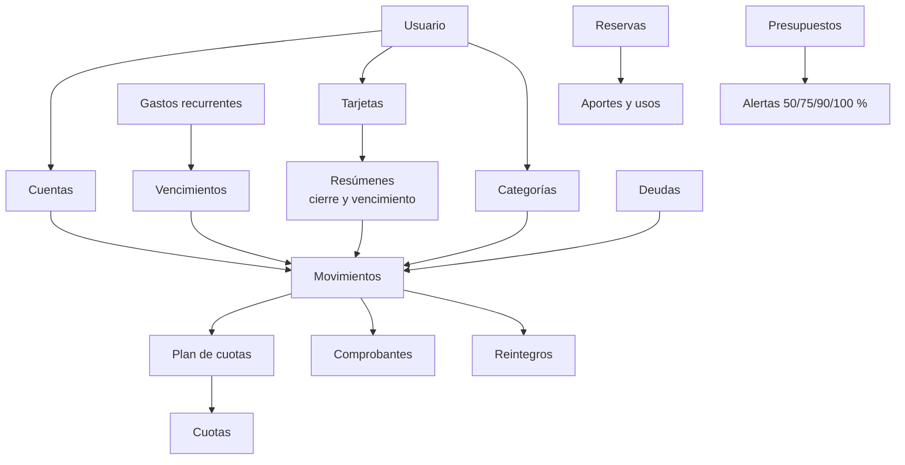

# Arquitectura

[← Volver al README](../README.md)

## Vista general

**Idea central:** el frontend es una aplicación estática sin servidor propio. Toda la lógica contable y la seguridad viven en Supabase; el hosting solo entrega archivos.

## Hosting y despliegue

| Pieza | Qué hace |
|---|---|
| **Hostinger (VPS)** | Aloja el contenedor del frontend. Los datos financieros no viven acá |
| **Easypanel** | Panel de contenedores sobre el VPS: construye la imagen Docker desde el repositorio, la ejecuta y gestiona el dominio con HTTPS |
| **Docker + Nginx** | Imagen en dos pasos: compila la app con Vite y la sirve con Nginx, con cabeceras de seguridad y política de contenido (CSP) |
| **GitHub (privado)** | Fuente del despliegue. Easypanel accede con una *deploy key* de solo lectura, sin credenciales personales |
| **Supabase (nube)** | Postgres, Auth y Storage administrados. Es el único lugar con datos |

**Flujo de entrega**
1. Programo y pruebo en **desarrollo** (entorno local + proyecto Supabase de desarrollo con datos de prueba).
2. Hago **backup** de la base de producción.
3. Aplico las **migraciones** a producción, siempre antes de publicar el código que las necesita.
4. Subo el código a GitHub y ejecuto *Implementar* en Easypanel, que reconstruye y publica el contenedor.

**Por qué esta separación:** cambiar o escalar el hosting no toca los datos, y ningún secreto de servidor llega al navegador. El frontend solo lleva la clave pública de Supabase; la seguridad la imponen las políticas RLS de la base.

## Capas

| Capa | Tecnología | Responsabilidad |
|---|---|---|
| Presentación | React 19, TypeScript, Tailwind, shadcn/ui | Pantallas por módulo (inicio, movimientos, cuentas, tarjetas, cuotas, recurrentes, presupuestos, deudas, reservas, calendario, comprobantes, reintegros, exportar, ajustes). Diseño oscuro, minimalista, móvil primero |
| Estado y formularios | TanStack Query, React Hook Form, Zod | Datos del servidor y validación en cliente (importes solo en formato argentino) |
| Lógica de dominio | Módulos puros y testeados | Cálculos, fechas locales (Buenos Aires), dinero con decimales exactos |
| Datos y reglas | Postgres (Supabase) | Esquema versionado en migraciones, vistas, funciones transaccionales (RPC), disparadores |
| Identidad y acceso | Supabase Auth + RLS | Cada usuario solo ve lo suyo; registro público cerrado |
| Archivos | Supabase Storage | Bucket privado, carpeta por usuario, solo JPG/PNG/WebP/PDF, máx. 10 MB |
| Entrega | Hostinger + Easypanel, Docker + Nginx | Frontend estático en contenedor, con cabeceras de seguridad y CSP |

## Principios de diseño

1. **La base es la fuente de verdad.** Presupuestos, alertas, saldos y resúmenes se calculan en Postgres; el frontend no duplica reglas.
2. **Dinero exacto.** Tipo numérico decimal, nunca flotantes; importes positivos con tipo/dirección (una sola convención de signo).
3. **Operaciones compuestas atómicas e idempotentes.** Transferencias, pagos de resumen, de cuotas y de deudas, reintegros y reservas van por funciones transaccionales con clave de idempotencia (el doble clic no duplica).
4. **Nada se borra de verdad.** Anulación lógica con motivo y auditoría. La única excepción ("Restablecer datos") exige frase de confirmación y contraseña reciente, y deja constancia.
5. **Mínimo privilegio.** Usuarios anónimos sin permisos; las tablas con reglas contables solo se escriben por RPC; ningún secreto de servidor en el frontend.
6. **Sin doble conteo por diseño.** Una compra en cuotas es un solo gasto; sus cuotas son compromisos. Una cuota incluida en un resumen de tarjeta no se lista aparte.

## Modelo conceptual

## Calidad y operación

- **Pruebas en tres capas:** base de datos (reglas, permisos, aislamiento entre usuarios; 460 aserciones), lógica de la app (220+) y recorridos de punta a punta con usuarios temporales.
- **Rendimiento:** con 20.000 movimientos, listados < 15 ms y resumen, saldos y presupuestos < 20 ms en la base.
- **Seguridad:** RLS en todas las tablas, comprobantes privados con enlaces firmados de 60 s, 0 vulnerabilidades en lo que se publica, registro público cerrado.
- **Ambientes:** desarrollo para programar y probar; producción separada. Backup antes de cada cambio de base de producción.
- **Migraciones versionadas** (16 en total) y restauración de backup verificada por huella y hash.

## Límites conocidos

- Solo uso individual; sin conexión bancaria ni importación automática (queda como evolutivo).
- Cuotas siempre iguales y mensuales; sin frecuencia semanal o quincenal en recurrentes.
- Los avisos de presupuesto son solo dentro de la app (sin push ni mail).
