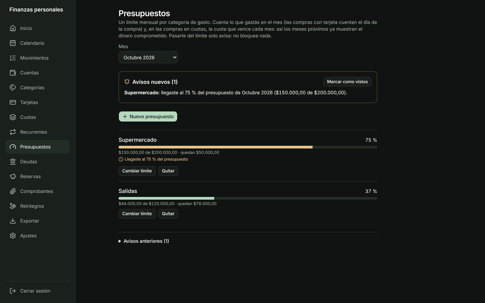
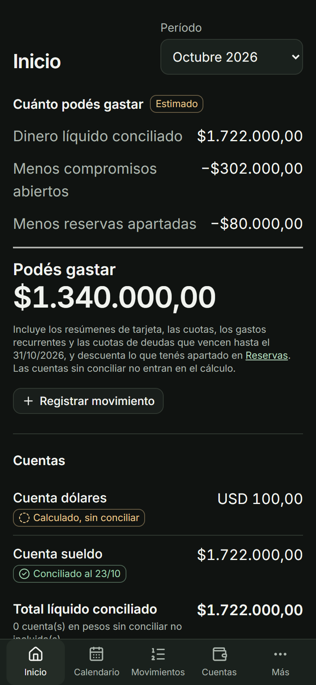

# Finanzas Personales: capturas

Capturas de la aplicación con **datos 100 % ficticios** (cuentas, comercios e importes inventados). El código no se publica; este repositorio solo documenta el caso de estudio.

## Inicio

"Cuánto podés gastar" se calcula a partir del dinero conciliado, menos los compromisos abiertos y las reservas apartadas, y se rotula siempre como **estimado**. Cada saldo dice si es **calculado** o **conciliado** con el extracto: nunca aparece un "saldo real" sin conciliar. Los dólares van en un bloque aparte: la app no convierte por su cuenta.

## Tarjetas

Una compra con tarjeta cuenta como gasto el día de la compra; pagar el resumen no es otro gasto. El resumen suma la cuota de una compra en cuotas (no la compra entera), así que no se cuenta dos veces.

## Presupuestos

Un límite mensual por categoría. El aviso aparece una sola vez por umbral (50, 75, 90 y 100 %) y solo avisa: no bloquea nada.

## En el celular

La misma información, con la navegación principal a un toque.

---
*Desarrollada con asistencia de IA (Claude Code). Definición de producto, reglas de negocio y decisiones: propias.*
